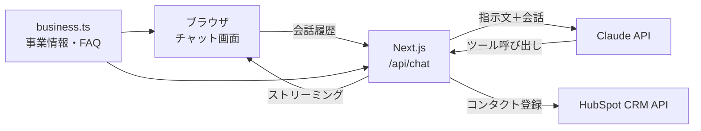

# Asuka Web Studio（AIチャットボット付き Web制作サイト）

個人のWeb制作事業を想定したサイトに、問い合わせ対応用のAIチャットボットを組み込んだポートフォリオ作品です。
チャットボットはサイトの料金・FAQをもとに質問に答え、相談内容を聞き取ってHubSpot（CRM）に自動で登録します。

**公開URL**：https://asuka-web-studio.vercel.app/

> ※ ポートフォリオ用のデモサイトです。掲載している料金・サービス内容は架空のものです。

## 主な機能

- **AIチャットボット（FAQ対応）**
  サイトの料金・納期・FAQをもとに回答。返答はストリーミングで1文字ずつ表示
- **問い合わせのCRM自動登録**
  会話の中で名前・メールアドレス・相談内容を聞き取り、確認後にHubSpotへコンタクトとして登録
- **サイトとボットのデータ一元管理**
  事業情報を1つのファイルにまとめ、サイトの表示とAIへの指示文の両方で同じデータを使用
- **レスポンシブ対応・アクセシビリティ配慮**
  キーボード操作、読み上げ、動きを減らす設定（prefers-reduced-motion）に対応

## 使用技術

| 分類 | 技術 |
|---|---|
| フレームワーク | Next.js（App Router）/ React |
| 言語 | TypeScript |
| スタイル | CSS Modules |
| AI | Claude API（Haiku）/ Vercel AI SDK |
| CRM連携 | HubSpot CRM API |
| バリデーション | Zod |
| ホスティング | Vercel |

## 構成



- APIキーはサーバー側（Route Handler）でのみ使用し、ブラウザには公開しない
- AIは「登録する情報」を判断して渡すだけで、実際のCRM登録はサーバー側のコードが実行する

## ディレクトリ構成

```
src/
├── app/
│   ├── page.tsx              # トップページ（各セクションを配置）
│   └── api/chat/route.ts     # チャットAPI（Claude呼び出し・ツール定義）
├── components/               # 各セクション・チャットウィジェット
├── data/business.ts          # 事業情報・料金・FAQ（サイトとボットで共用）
├── lib/
│   ├── systemPrompt.ts       # business.ts からAIへの指示文を生成
│   └── hubspot.ts            # HubSpotへの登録処理
└── styles/common.module.css  # 共通スタイル
```

## 工夫した点

- **回答の正確さ**：事業情報に書かれていないこと（見積もり額・空き状況など）は推測で答えず、問い合わせに案内するよう指示
- **ツール呼び出しの安全性**：Zodでメール形式などをチェックし、条件を満たしたときだけCRMに登録。登録前にお客様の確認を取る流れにした
- **重複登録への対応**：同じメールアドレスのコンタクトがある場合（HTTP 409）は、新規作成から更新に切り替え
- **使いすぎ防止**：会話件数・1メッセージの文字数・返答の長さに上限を設定し、APIの利用料金が膨らまないようにした

## 苦労した点

- **APIルートの配置**：Next.jsでは `src/app` 配下のフォルダ構成がそのままURLになるため、`route.ts` の置き場所を間違えて404になった。ファイルの配置とURLの関係を理解して解決
- **ビルド時のエラー**：フッターの年表示に `new Date()` を使ったところ、Cache Components の仕様でビルドエラーに。固定値に変更して解決
- **外部APIの認証**：APIキーのコピーミスによる認証エラーを、サーバーログのエラー内容から原因を特定して解決

## ローカルで動かす方法

```bash
git clone https://github.com/AsukaMii/asuka-web-studio.git
cd asuka-web-studio
npm install
```

プロジェクト直下に `.env.local` を作成し、APIキーを設定します。

```bash
ANTHROPIC_API_KEY=your_claude_api_key
HUBSPOT_SERVICE_KEY=your_hubspot_service_key
```

HubSpotでは、コンタクトに内部名 `inquiry_detail`（複数行テキスト）のプロパティを作成しておきます。

```bash
npm run dev
```

http://localhost:3000 で起動します。

## 今後の改善予定

- 会話ログの保存と管理画面
- レート制限（同じ利用者からの連続リクエストの制限）
- 他サイトにも設置できる埋め込み型ウィジェット化